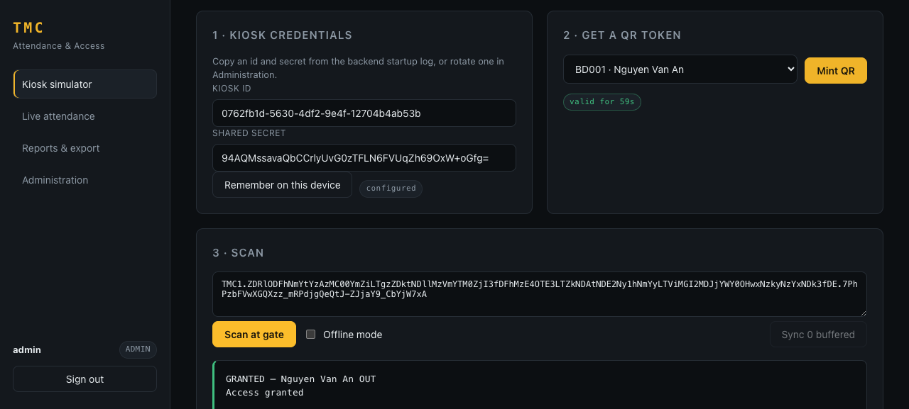
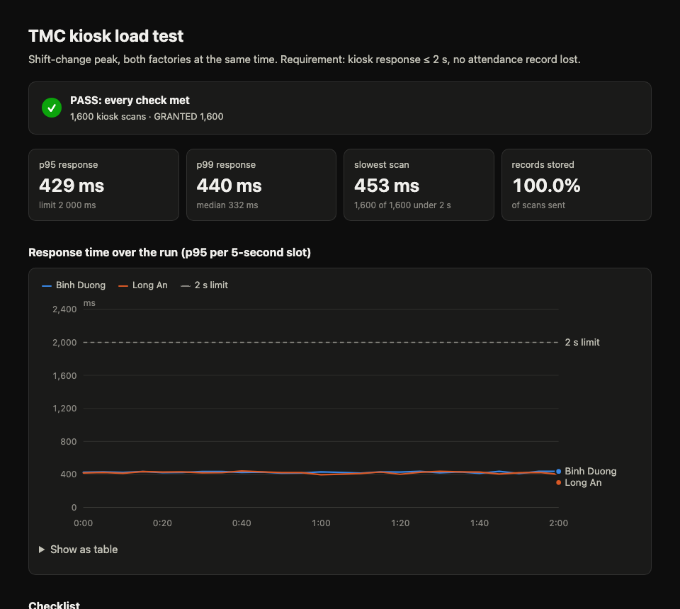

# TMC_Attendance

QR-based attendance and access control for **TMC Manufacturing JSC** (Binh Duong and Long An
factories). This repository is the M2 implementation of the architecture described in the course
report: a modular monolith with an internal event-driven core, edge kiosk buffering, dynamic QR
credentials and a tamper-evident audit trail.



## What it demonstrates

| Concern | How it is implemented |
|---|---|
| Record before unlock | `ScanOrchestrator` persists a `PENDING` row, then calls the turnstile, then marks it `COMPLETED`. A crashed gate can never lose a scan. |
| No duplicates | A kiosk-generated `clientEventId` is the primary key of `processed_events`, so a retry returns the original result instead of opening the gate twice. |
| Transactional outbox | `attendance_records` and `outbox_events` are written in one transaction; `OutboxRelay` delivers later. |
| Network loss | The kiosk buffers scans locally and replays them through `POST /api/kiosk/scans/sync`, keeping the **original** scan time. |
| Static QR exposure | Tokens are HMAC-signed, contain no PII, expire in 60 s, and are bound to a credential version that can be rotated or revoked. |
| Buddy punching | Anti-passback: a repeated scan in the same direction inside the cooldown is rejected; an `OUT` without an `IN` is rejected. |
| Gate failure | 1.5 s timeout + circuit breaker; the record lands in a recovery queue and a guard can open the gate manually. |
| HR deadline | Export runs on the 1st from 06:00 and retries every 30 min until 11:30; it is idempotent per `period + factory` and records a checksum. |
| RBAC + audit | Six roles with one job each (least privilege, separation of duties): HR owns employee data, the guard owns gates, admin (IT) audits but cannot change data, a supervisor sees only their team. JWT for staff, per-kiosk HMAC for devices, hash-chained audit log. |
| Human fallback | When a phone, kiosk or network is down, the **security guard** records the entry by hand: same access rules as a scan, reason required, marked `MANUAL` with the guard's name, audited, and listed for **HR review**. Plus a printable **evacuation list** of everyone inside. |
| Live site map | `GET /api/live/sites`: who is inside each factory, gates OPEN / closed / STUCK / OFFLINE (kiosk heartbeat), live feed. Read-only, so the scan path is untouched. Executive gets head counts only. |
| Privacy | QR payload carries only `employeeId|jti|exp|version`; phone numbers and kiosk secrets are AES-GCM encrypted at rest. |

## Architecture at a glance

```
portal (React)  ──JWT──▶  ┌──────────────────── modular monolith ────────────────────┐
                          │ identity   gate   attendance   reporting   admin        │
kiosk ──HMAC─────────────▶│   │         │         │            │          │          │
                          │   └── api ──┴── api ──┘            │          │          │
                          │              security (JWT, RBAC, HMAC, audit)           │
                          │              integration (turnstile, payroll, outbox)    │
                          └───────────────────────┬─────────────────────────────────┘
                                                  ▼
                                        PostgreSQL 16 (partitioned)
```

- **How to use it, role by role:** [docs/USER_GUIDE.md](docs/USER_GUIDE.md)
- **SOLID, with proof:** [docs/SOLID.md](docs/SOLID.md)
- **API reference:** Swagger UI at <http://localhost:8080/swagger-ui.html> once the backend runs.

## Quick start (fresh clone)

### 0. Check you have the tools

| Tool | Check command | Need |
|---|---|---|
| Docker Desktop (running) | `docker info` | no error |
| Java | `java -version` | 21 or newer |
| Node.js | `node -v` | 18 or newer |

You do **not** need Maven: the `./mvnw` wrapper downloads it.

### 1. Start the database (terminal 1)

```bash
cd TMC_Attendance
docker compose up -d --wait db
```

✅ Worked if: the last line says `Container tmc-postgres Healthy`.

### 2. Start the backend (same terminal)

```bash
cd backend
./mvnw spring-boot:run          # Windows: mvnw.cmd spring-boot:run
```

✅ Worked if: you see `Started TmcApplication`, plus a box listing the demo users and
**kiosk ids with `secret=...`**. The first start takes a few minutes while Maven downloads.
Leave this terminal open.

> You don't need these secrets for the demo: in the website, sign in as `admin` →
> **Kiosk simulator** → **Set up all gates** sets up the browser in one click.

### 3. Start the website (terminal 2)

```bash
cd TMC_Attendance/portal
npm install
npm run dev
```

✅ Worked if: you see `Local: http://localhost:5173/`. Open it in the browser.

### 4. Sign in

Click a demo account chip on the login page, or type it. Password for all: `Password@123`.
The sidebar always shows **who** is signed in: name, employee code, factory and role.

| Username | Who | Role | Main job (lands on) |
|---|---|---|---|
| `bd001` … `bd008`, `la001` … `la004` | one login per employee | Employee | show own QR, check own attendance (Kiosk simulator) |
| `supervisor` | BD002 Tran Thi Binh | Production supervisor | watch **own team** only (Live attendance) |
| `guard` | (staff account) | Security guard | human backup: broken gates, manual check-in when a phone/kiosk is down, evacuation list (Live attendance) |
| `hr` | BD003 Le Quang Cuong | HR staff | employee records, Rotate QR, Payroll export (Employees) |
| `executive` | (staff account) | Executive management | numbers per factory, no names (Reports) |
| `admin` | (staff account) | System administrator (IT) | kiosks, audit log, demo tool (Administration) |

Full permission matrix and the reasoning (least privilege, separation of duties): see
**Who's who** in [docs/USER_GUIDE.md](docs/USER_GUIDE.md).

`employee` still works as a login and is the same person as `bd001`. Missing accounts are added
automatically when the backend starts, so an existing database gets them without a reset.

Next: follow the 10-minute demo in [docs/USER_GUIDE.md](docs/USER_GUIDE.md).

### Stop / reset

```bash
# stop: Ctrl+C in both terminals, then
docker compose stop db
# wipe all data and start fresh (the seed runs again and reprints kiosk secrets)
docker compose down -v
```

### Something went wrong?

| You see | Fix |
|---|---|
| `Port 8080 was already in use` | Another app uses 8080. Run the backend on another port **and** tell the portal: `SERVER_PORT=18080 ./mvnw spring-boot:run`, then `VITE_API_BASE=http://localhost:18080 npm run dev` |
| `port is already allocated` / backend cannot connect to DB on 5432 | A local PostgreSQL already uses 5432. Use another port: `POSTGRES_PORT=55432 docker compose up -d --wait db`, then start the backend with `SPRING_DATASOURCE_URL=jdbc:postgresql://localhost:55432/tmc ./mvnw spring-boot:run` |
| Vite picks `5174` instead of `5173` | Fine, use the URL it prints. The backend accepts any `localhost` port. |
| Scan says `DENIED` | Read the reason: usually the wrong direction (OUT gate for someone who's out). Switch **Scanning at** to an IN gate. See "Why was I DENIED?" in the user guide. |
| Login says "Failed to fetch" | The backend is not running, or the portal points at the wrong port (see `VITE_API_BASE` above). |
| `Cannot connect to the Docker daemon` | Start Docker Desktop and wait until it says "running". |
| No `secret=` lines in the log | Normal if the database already had data. Use **Kiosk simulator → Set up all gates** as admin. |
| Scan says the gate password is out of date (`KIOSK_BAD_SIGNATURE`) | Someone rotated that gate's secret since this browser was set up. As admin: **Kiosk simulator → Set up all gates** again. |

> `.env` / `.env.example` are read by **Docker Compose only**. When you run `./mvnw` directly, pass
> settings as environment variables as shown above.

### Optional: run the backend in Docker too

```bash
docker compose --profile app up --build     # backend on :8080, then start the portal as in step 3
```

## Tests

```bash
cd backend
./mvnw verify        # unit + Testcontainers integration + ArchUnit rules (Docker must be running)
```

✅ Worked if: `BUILD SUCCESS`. 49 tests:

- `QrTokenServiceTest` (8): expiry, backdated scans rejected, tampering, malformed input, nonce uniqueness, clock drift.
- `AntiPassbackPolicyTest` (7): the IN/OUT state matrix.
- `ScanOrchestratorTest` (4): Mockito `InOrder` proves persist → actuate → complete; idempotent replay; offline replay.
- `LiveSiteServiceTest` (4): who counts as inside, gate OPEN / STUCK / OFFLINE, no names for head-count-only viewers, a supervisor sees only their team.
- `HrExportServiceTest` (3): a failed HR/Payroll push is stored with its error, retried until sent, and a sent batch is never sent twice.
- `ManualEntryServiceTest` (5): a guard's manual entry needs a reason, can't let in someone from another factory, needs a direction on two-way gates.
- `AttendanceFlowIT` (8): real PostgreSQL via Testcontainers: end-to-end scan, duplicate suppression, offline timestamps, guard manual entry (no kiosk, marked MANUAL, anti-passback), audit chain, unauthenticated access.
- `ArchitectureTest` (10): ArchUnit rules that make SOLID executable: controllers never touch repositories, domain never imports adapters, modules read each other only through ports (DIP), lookups are narrow interfaces (ISP), no caller names a concrete access rule (OCP). See [docs/SOLID.md](docs/SOLID.md).

### End-to-end check of the running app (every role)

```bash
python3 scripts/e2e_check.py            # 55 checks, ~1.5 min (waits for a QR to expire)
python3 scripts/e2e_check.py --chaos    # 7 checks, backend started with TMC_TURNSTILE_MODE=chaos
```

Add `--base-url http://localhost:18080` if the backend runs on another port.

## Load test (NFR: ≤ 2 s at peak, no lost records)

**One command** starts the database, a fake turnstile with realistic delay, and the backend wired to
it over HTTP. Then it runs k6 and writes an HTML report. You don't need to install k6: if it's
missing, the script uses Docker.

```bash
perf/showcase.sh smoke     # ~2 min  · 20 scans per factory (sanity check)
perf/showcase.sh burst     # ~5 min  · 800 scans per factory in 2 min, both factories at once (15× the real rate)
perf/showcase.sh peak      # ~33 min · 800 scans per factory over 30 min (exactly the requirement)

GATE_DELAY_MS=2500 perf/showcase.sh smoke   # gate slower than the 1.5 s timeout → fallback path
SERVER_PORT=18080 POSTGRES_PORT=55432 perf/showcase.sh burst   # if 8080 / 5432 are busy
```

✅ Worked if: the last lines say `✅ PASS: all thresholds met` and print the report path
(`perf/results/<time>-<profile>/report.html`). Open it in a browser.



**What one run checks.** Thresholds fail the run with exit code 99:

| Check | How |
|---|---|
| Kiosk response p95 and p99 < 2 s, overall and per factory | k6 times only the kiosk's `POST /api/kiosk/scans` (verify → save → open gate → complete) |
| Every scan produced a stored record | Each response must carry a `recordId`; then the DB is queried after the run: **stored = sent**, no duplicates |
| Audit log not corrupted by concurrency | `GET /api/audit/verify` re-hashes the whole chain after the run |
| Gate opened once per completed record | Fake turnstile's counter = number of `COMPLETED` records |
| The load really happened at the planned rate | `dropped_iterations == 0` |

Every scan is a **real** first check-in: setup registers fresh employees (one per scan) and each one
mints a live 60-second QR, so nothing is cached or faked on the server side.

**Recorded results (MacBook, Apple Silicon, 6 Nov 2026).** Open the HTML reports in `docs/load-test/`:

| Run | Scans | p95 | p99 | Stored / sent | Result |
|---|---|---|---|---|---|
| [burst](docs/load-test/report-burst.html): 800/factory in 2 min, gate 300 ms | 1,600 | 429 ms | 440 ms | 1,600 / 1,600 | ✅ |
| [slow gate](docs/load-test/report-slow-gate.html): gate 2.5 s (> 1.5 s timeout) | 40 | 1,560 ms | 1,570 ms | 40 / 40 (all to guard queue) | ✅ |

> Windows: run the `.sh` scripts from **Git Bash** or **WSL**. `scripts/e2e_check.py` and `perf/report.py` run anywhere with Python 3.

Already have a backend running? Run only the test: `BASE_URL=http://localhost:8080 perf/run-load-test.sh burst`.

## Repository layout

```
backend/    Spring Boot 3.5 · Java 21 · PostgreSQL · Flyway · Resilience4j
  com.tmc.identity     employees, QR credentials, token minting
  com.tmc.gate         gates, kiosks, provisioning bundles
  com.tmc.attendance   scan pipeline (the core)
  com.tmc.reporting    monthly report, HR export
  com.tmc.admin        config, seeding, partition maintenance
  com.tmc.security     JWT, RBAC, kiosk HMAC, audit chain
  com.tmc.integration  turnstile + payroll adapters, outbox relay
  com.tmc.shared       outbox, idempotency, crypto, errors
portal/     React + Vite + TypeScript (kiosk simulator, supervisor, reports, admin)
docs/       user guide, screenshots, sample load-test reports
perf/       k6 load test, fake turnstile, one-command showcase, report builder
scripts/    e2e_check.py: every role's story against the running app
```

## Configuration

| Property | Default | Purpose |
|---|---|---|
| `TMC_TURNSTILE_MODE` | `stub` | `stub`, `http` or `chaos` |
| `TMC_TURNSTILE_URL` | `http://localhost:9099` | Vendor turnstile API base URL |
| `TMC_SEED_ENABLED` | `true` | Insert demo data on an empty database |
| `TMC_SECURITY_JWT_SECRET` | demo value | HS256 signing key (base64, 32+ bytes) |
| `TMC_SECURITY_QR_SECRET` | demo value | Root key for per-employee QR derivation |
| `TMC_SECURITY_DATA_KEY` | demo value | AES-GCM key for PII and kiosk secrets |

> The defaults are development values. Supply real secrets through the environment in any
> shared deployment.
