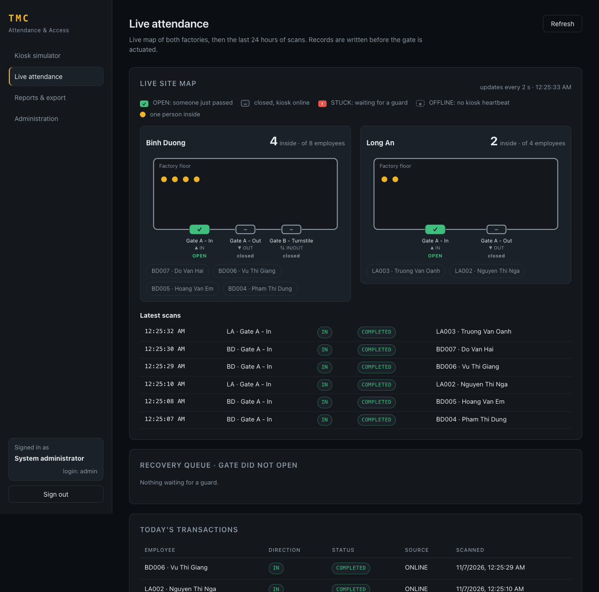
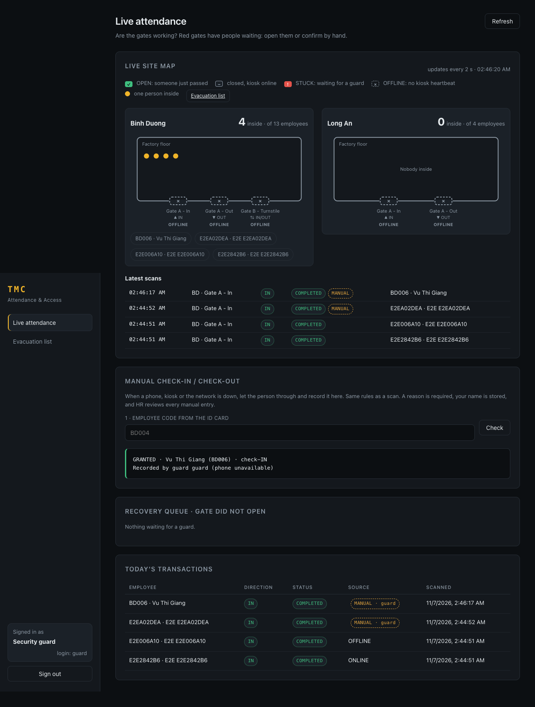
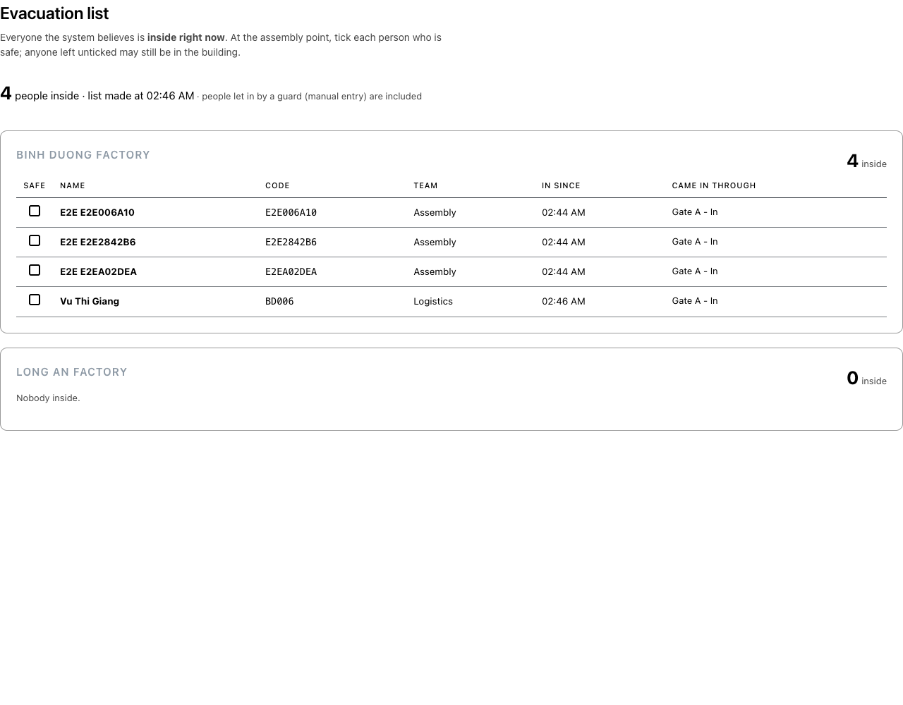

# TMC Attendance: User Guide

> **TL;DR:** Employees show a QR on their phone. The gate scans it. The system saves the scan
> *first*, then opens the gate. HR exports the month to Payroll. Everyone else watches.

Not running yet? Do the **Quick start** in the [README](../README.md) first (≈10 min).
Every password is `Password@123`.

---

## 🧭 The 3 ideas you need

1. **QR changes every 60 seconds.** A screenshot is useless a minute later.
2. **Save first, open second.** A scan is written to the database *before* the gate moves.
   Network drops or a broken gate can't lose it.
3. **Each role sees only its own pages.** The left menu changes per login.

> 💡 The **Kiosk simulator** page stands in for real hardware: it plays the gate scanner
> *and* the employee's phone, so you can demo everything from one browser.

---

## 👥 Who's who: one role, one question

| Login | Who | Role | Their one question |
|---|---|---|---|
| `bd001`…`bd008`, `la001`…`la004` | one login per employee | Employee | "Did I clock in properly?" |
| `supervisor` | BD002 Tran Thi Binh (team: Binh Duong · Quality) | Production supervisor | "Is **my team** here, who is missing?" |
| `guard` | staff account | Security guard | "Are the **gates** working, is anyone stuck?" |
| `hr` | BD003 Le Quang Cuong | HR staff | "Are the **records** right, and sent to Payroll on time?" |
| `executive` | staff account | Executive management | "How are we doing **overall**?" (numbers, no names) |
| `admin` | staff account | System administrator (IT) | "Is the **system** running and safe?" |

**Who may do what** (the server enforces this; the menu only mirrors it):

| | 👷 Employee | 🧑‍🏭 Supervisor | 🛡️ Guard | 🗂️ HR | 📊 Executive | ⚙️ Admin (IT) |
|---|:-:|:-:|:-:|:-:|:-:|:-:|
| Show **my own** QR, see **my own** attendance | ✅ | ✅ | | ✅ | | |
| Live map + scans **with names** | | ✅ own team | ✅ | ✅ | counts only | ✅ (watch) |
| Recovery queue (broken gates) | | | ✅ act | | | 👀 watch |
| **Open a gate by hand** | | | ✅ | | | |
| **Manual check-in/out** (phone, kiosk or network down) | | | ✅ | reviews | | |
| **Evacuation list** (everyone inside, printable) | | | ✅ | ✅ | | ✅ |
| Monthly report **with names** | | ✅ own team | | ✅ | | ✅ |
| Company summary per factory | | | | ✅ | ✅ | ✅ |
| **Export to Payroll** | | | | ✅ | | |
| **Register / edit employees, Rotate QR** | | | | ✅ | | |
| Gate kiosks (set up, rotate secret) | | | | | | ✅ |
| Audit log + verify | | | | | | ✅ |
| *Demo tool:* show **any** employee's QR | | | | | | ✅ (demo only) |

Why it's split this way:
- **Least privilege:** everyone gets just enough for their own job. The executive gets numbers, not names. The supervisor sees one team.
- **Separation of duties:** HR changes employee data; admin checks the audit log and **cannot** change that data. The guard opens gates and records manual entries; **HR reviews** every manual entry; admin can only watch.

> 👀 **Who am I?** Look at the bottom of the left sidebar: name, employee code, factory, role and
> login name. `employee` is an old alias of `bd001` (same person).

---

## ⏱️ The 10-minute demo (do it in this order)

Tick each box as you go. ✅ = what you should see.

### Part A: set up the gates (as `admin`) · 30 s
- [ ] Sign in as **admin** → open **Kiosk simulator**.
- [ ] In **1 · Set up the gates**, click **Set up all gates**.
- [ ] ✅ "5 gates are set up in this browser". A **Scanning at** dropdown appears.
      Everyone who signs in on this browser can use it, not just admin.

> What just happened: the server gave this browser a brand-new **gate password** (kiosk secret)
> for every gate. Every scan is signed with it, so the server knows it came from a real gate.
> Clicking again makes new passwords and the old ones stop working.

### Part B: walk in, walk out · 2 min
- [ ] **Scanning at** → `Binh Duong · Gate A - In · check-IN`.
- [ ] In **2 · Employee's phone shows a QR** (the admin's *DEMO TOOL*: plays anyone's phone), pick **BD002** → **Show QR code**.
      (Pick someone other than the person you'll log in as later, so their in/out history stays simple.)
- [ ] ✅ A QR with a countdown `valid for 60s`.
- [ ] In **3 · The gate scans it** → **Scan at gate**.
- [ ] ✅ `GRANTED · … (BD002) · check-IN`.
- [ ] Click **Scan at gate** again with the same QR.
- [ ] ✅ `DENIED · … · Already checked IN less than 3 minutes ago`. No "buddy punching".
- [ ] **Scanning at** → `Binh Duong · Gate A - Out · check-OUT` → **Show QR code** → **Scan at gate**.
- [ ] ✅ `GRANTED · … (BD002) · check-OUT`.

### Part C: break things on purpose · 3 min
- [ ] **Stolen screenshot:** **Show QR code**, wait until the countdown hits 0, scan.
      ✅ `EXPIRED`.
- [ ] **Edited QR:** change one letter at the end of the token text, scan.
      ✅ `INVALID_TOKEN`.
- [ ] **Network down:** pick an **IN** gate, tick **Offline mode** → **Show QR code** + **Buffer scan** for 2 different employees (e.g. BD003, BD004).
      ✅ "Buffered locally (2 pending)". The gate did *not* open.
- [ ] Untick **Offline mode** → **Sync 2 buffered**.
      ✅ Both `GRANTED`. In **Live attendance** they show `source = OFFLINE` with the *original* time.

### Part C½: the live site map (two windows) · 2 min
- [ ] Keep the **Kiosk simulator** open in window 1 (as admin, gates set up).
- [ ] Open a **second window** → **Live attendance**. At the top: **Live site map** of both factories.
- [ ] ✅ Every gate shows **– closed** (kiosk online). Grey **× OFFLINE** means no simulator window is open.
- [ ] In window 1, check someone **IN** → watch window 2:
      ✅ the gate flashes **✓ OPEN**, a yellow dot and their name appear inside, the count goes up.
- [ ] Check them **OUT** at an Out gate → ✅ the dot disappears, the count goes down.

> Turnstiles have no door sensor: **OPEN** means "someone passed in the last 4 seconds".

### Part D½: phone dead or kiosk down (as `guard`) · 2 min
The guard is the **human backup** when the machine can't do its job.
- [ ] Sign in as **guard** → **Live attendance** → **Manual check-in / check-out**.
- [ ] Type the code from the ID card, e.g. `bd006` → **Check**.
      ✅ "Vu Thi Giang · BD006 · Logistics · outside". Compare with the ID card.
- [ ] The gate is pre-selected (an IN gate, because she is outside). Reason: **Phone dead / forgotten**.
      Note: "battery dead, checked ID card" → **Record IN for Vu Thi Giang**.
- [ ] ✅ `GRANTED · … · Recorded by guard guard (phone unavailable)`. The live feed shows **MANUAL**,
      and she counts as inside. The door does **not** flash OPEN: no machine opened anything.
- [ ] Press **Record** again → ✅ `DENIED`. Anti-passback applies to guards too.
- [ ] Sign in as **hr** → **Reports & export** → **Manual entries to review**: ✅ the entry, the reason and the guard's name.

### Part D¾: fire drill (as `guard`) · 30 s
- [ ] **Evacuation list** (menu, or the button on the map) → ✅ everyone inside, per factory, sorted by name,
      with a tick box for the assembly point → **Print**.

### Part D: broken gate (as `guard`) · 2 min
- [ ] Stop the backend (Ctrl+C) and restart it with a fake broken turnstile:
      `TMC_TURNSTILE_MODE=chaos ./mvnw spring-boot:run`
- [ ] At an **IN** gate: **Show QR code** for a new employee → **Scan at gate**.
      ✅ `GATE_UNAVAILABLE` with `manualFallback: true`. The record is still saved.
- [ ] Sign out → sign in as **guard** → **Live attendance**.
- [ ] ✅ The scan sits in **Recovery queue · gate did not open**, and on the map that gate is **! STUCK · 1 waiting** (red).
- [ ] Click **Open gate** (tries the turnstile again) or **Admitted manually** (the guard let them in).
- [ ] Restart the backend normally afterwards (`./mvnw spring-boot:run`).

### Part E: month end (as `hr`, then `admin`) · 1 min
- [ ] Sign in as **hr** → **Reports & export** → pick factory + month.
- [ ] ✅ One row per employee: days present, check-ins, check-outs, first in / last out.
- [ ] Click **Export to HR/Payroll**, then click it **again**.
- [ ] ✅ Same batch both times, nothing sent twice.
- [ ] Sign in as **admin** → **Administration** → **Audit log** → **Verify hash chain**.
- [ ] ✅ `valid`. Nobody has secretly edited the log.

🎉 Done. You've hit every requirement in the assignment.

---

## 🙋 Stories per role

Format: **I want to…** → *do this* → ✅ *see this*. Each role lands on its own main page after signing in.

### 👷 Employee (`bd001` … `bd008`, `la001` … `la004`) · lands on Kiosk simulator
- **Who am I?** → bottom-left sidebar, e.g. `Dang Van Minh · LA001 · Long An`.
- **Get my QR** → Kiosk simulator → **Show my QR code** → ✅ "QR of *my name* (*my code*)" + 60 s countdown.
- **Enter / go home** → **Scanning at** an IN gate / OUT gate → **Scan at gate** → ✅ `GRANTED · check-IN` / `check-OUT`.
- **Did it count?** → **My attendance** → ✅ days present this month, In / Out time per day, "missing" if I forgot to scan out.
- 🚫 Can't see anyone else.
- Needs the gates set up in this browser first: an admin clicks **Set up all gates** once (Part A).

### 🧑‍🏭 Production supervisor (`supervisor`, BD002) · lands on Live attendance
- **Is my team here?** → Live attendance → **Live site map · Your team: Quality**: only Binh Duong, only my team's people.
- **My team's scans today** → Live attendance → **My team's scans**.
- **My team's month** → Reports & export → only my team's rows.
- **My own attendance** → Kiosk simulator (own QR) and **My attendance**, like any employee.
- 🚫 Other teams, gate operations, export and employee records are not theirs.

### 🛡️ Security guard (`guard`) · lands on Live attendance
**The human backup when the machine can't do its job.**

| What breaks | What the guard does |
|---|---|
| Turnstile motor (scan OK, door stuck) | map shows red **! STUCK** → **Recovery queue** → **Open gate** or **Admitted manually** |
| Employee's phone dead / forgotten | checks the ID card → **Manual check-in / check-out**, reason "phone" |
| Kiosk dead (map shows grey × OFFLINE) | **Manual check-in / check-out**, reason "kiosk down" |
| Network down | kiosks buffer and sync later; guard records by hand if people must pass now |
| Fire / evacuation | **Evacuation list** → print → tick people at the assembly point |

Guard rails (so it's a fallback, not a back door):
- A manual entry passes **the same checks as a scan**: active employee, right factory, anti-passback, gate direction.
- A **reason is required** ("other" needs a note). The record is marked **MANUAL** with the guard's name and goes to the audit log.
- **HR reviews** every manual entry in the monthly report: the guard acts, HR checks.
- 🚫 No reports, no QR codes: a guard never creates QR codes.

### 🗂️ HR staff (`hr`, BD003 Le Quang Cuong) · lands on Employees
- **New hire** → **Employees** → **Register an employee** (code, name, factory, department = team, email, phone).
- **A QR was photographed or shared** → **Employees** → **Rotate QR** → ✅ every QR that person already showed stops working at once; they just show a new one.
- **Check the month** → Reports & export → factory + month → one row per employee.
- **Send to Payroll** → **Export to HR/Payroll** → ✅ batch under **Export batches**. Pressing twice is safe: same batch.
- **Review the guards' manual entries** → Reports & export → **Manual entries to review** (who, when, reason, note, which guard); the monthly table has a **Manual** column per person.
- The system also exports automatically on the **1st from 06:00**, retrying every 30 min until 11:30, before the 12:00 deadline.
- HR is also an employee: own QR and **My attendance**.

### 📊 Executive (`executive`) · lands on Reports & export
- **How are we doing?** → Reports & export → **Overview**: per factory, how many came this month, person-days, average days per person.
- **Right now** → Live attendance → the map with **head counts only**.
- Names and employee codes are removed **by the server**, not just hidden on screen (privacy requirement).
- 🚫 No export, no named lists.

### ⚙️ Administrator, IT (`admin`) · lands on Administration
- **Gate kiosks** → Administration → **Kiosks** (status, last heartbeat, **Rotate secret** if a kiosk password leaked).
- **Is the log untouched?** → **Audit log** → **Verify hash chain** → ✅ `valid`.
- **Set up this browser as the gates** → Kiosk simulator → **Set up all gates**.
- **Demo tool:** in the Kiosk simulator, admin can show *any* employee's QR so one laptop can demo everyone. Labelled DEMO TOOL; in production this would be switched off.
- 🚫 Cannot register or edit employees, rotate QR codes, change attendance or open gates. That keeps the person who audits separate from the people who change data.

---

## 🤔 "Why was I DENIED?"

The result line always says **who · which direction**, then the reason.

| You see | It means | Do this |
|---|---|---|
| `Already checked IN less than 3 minutes ago` | Same person, same direction, twice in a row (anti-passback) | Normal! Scan at an **OUT** gate instead, or wait 3 min |
| `Can't check out: this person is already checked out` | You're at an **OUT** gate, but they never came back in | Switch **Scanning at** to an **IN** gate |
| `Can't check out: this person has not checked in yet` | Their first scan ever is at an **OUT** gate | Switch to an **IN** gate |
| `EXPIRED` | The QR is older than 60 s | **Show QR code** again |
| `INVALID_TOKEN` / `QR not recognised` | The QR text was changed or isn't a TMC code | **Show QR code** again |
| "gate password is out of date" | Someone clicked **Set up all gates** / **Rotate secret** in another browser | Admin: **Set up all gates** again here |

> 💡 Every scan is about **one person's** in/out history. If admin already scanned, say, BD001 in
> and out, then `bd001` logging in afterwards is "already checked out". **Scanning at** an IN gate works.

---

## ✅ Assignment checklist: does it do what Assignment 2 asks?

How to read it: **Requirement** → *where you see it* → *how it was proven*.
"Test" = automatic (`./mvnw verify`). "Manual" = clicked/called against the running app.

### Functional requirements

| Requirement | Where you see it | Proof |
|---|---|---|
| User & QR code management | HR → Employees (register, Rotate QR); Employee → Show my QR code, My attendance | Manual ✔ · `e2e_check.py` (HR can, admin gets 403; rotated QR is denied) · `QrTokenServiceTest` |
| Gate station management | Kiosk simulator → Set up all gates; Admin → Kiosks → Rotate secret | Manual ✔ (fake kiosk with wrong secret → 401) |
| Attendance event recording | Kiosk simulator → Scan; Live attendance | Manual ✔ · `AttendanceFlowIT` · `ScanOrchestratorTest` |
| Reporting & auditing | Reports & export; Admin → Audit log | Manual ✔ · `HrExportServiceTest` · audit chain test |
| System administration | Administration (IT): kiosks, audit log | Manual ✔ |
| Send data to HR/Payroll via API before 12:00 on the 1st | Export button + scheduled job (1st, 06:00–11:30, every 30 min) | Manual ✔ (idempotent) · `HrExportServiceTest` (retry on failure) |
| Talk to the existing turnstile API | `TMC_TURNSTILE_MODE=stub/http/chaos` | Manual ✔ (stub and chaos) |

### Non-functional requirements

| Requirement | How the design meets it | Proof |
|---|---|---|
| Kiosk response ≤ 2 s | Turnstile call times out at 1.5 s, then falls back | Load test ✔ `perf/showcase.sh burst`: 1,600 scans, both factories at once, p95 **429 ms** · slow gate: p95 1.56 s |
| No lost attendance records | Save before unlock; outbox; offline buffer; duplicate-proof event ids | Load test ✔ DB has **1,600 stored / 1,600 sent**, no duplicates · `ScanOrchestratorTest` · `AttendanceFlowIT` |
| RBAC + full audit log | 6 roles + kiosk role, least privilege + separation of duties (see Who's who); supervisor scoped to own team; executive gets numbers without names; hash-chained audit log | Manual ✔ (403 for wrong role, 401 with no login) · `ArchitectureTest` |
| Personal data protection | QR holds no personal data; phone & secrets AES-GCM encrypted | Code review of `QrTokenService` / crypto utils |

### The two "Issues Encountered"

| Issue | Fix | Proof |
|---|---|---|
| Connection lost mid-transaction | **Machine fallback:** kiosk buffers offline and syncs later with the **original** time; broken gate → recovery queue. **Human fallback:** the guard records entries by hand (same rules, reason required, audited, HR reviews) | Manual ✔ (Parts C, D, D½) · `offlineReplayKeepsTheOriginalScanTime` · `ManualEntryServiceTest` · `guardManualEntryIsStored…` |
| Static QR can be copied | HMAC-signed QR, valid 60 s, can't be backdated, rotate/revoke per employee | Manual ✔ (`EXPIRED`, `INVALID_TOKEN`) · `QrTokenServiceTest` |

---

## 🔬 How it was verified (06 Nov 2026)

Each line is one command you can rerun.

| # | What | Command | Result |
|---|---|---|---|
| 1 | Automatic tests (unit + real PostgreSQL + architecture rules) | `cd backend && ./mvnw verify` | **49 / 49** pass (incl. 10 SOLID architecture rules) |
| 2 | Every role's story against the running app | `python3 scripts/e2e_check.py` | **55 / 55** pass (incl. who-am-I, team scope, manual entry, evacuation, who gets 403) |
| 3 | Broken gate story | `python3 scripts/e2e_check.py --chaos` (backend in chaos mode) | **7 / 7** pass |
| 4 | Peak load, both factories at once | `perf/showcase.sh burst` | ✅ p95 429 ms, 1,600 / 1,600 stored |
| 5 | Gate slower than its timeout | `GATE_DELAY_MS=2500 perf/showcase.sh smoke` | ✅ p95 1.56 s, 40 / 40 stored |
| 6 | Website builds | `cd portal && npm ci && npm run build` | no errors |

Saved reports from rows 4 and 5: `docs/load-test/report-burst.html`, `docs/load-test/report-slow-gate.html`.

---

## 🎤 Showcase plan (≈15 min, presenting it live)

**Before you go on stage (do it 10 min early):**
- [ ] Docker Desktop is running.
- [ ] Run `perf/showcase.sh smoke` once: it warms up Maven and proves the machine works.
- [ ] Open `docs/load-test/report-burst.html` in a tab, as a **backup** if Wi-Fi or the laptop misbehaves.

**On stage:**

| Min | Say | Do |
|---|---|---|
| 0–2 | "QR attendance for 2 factories. The 2 hard rules: answer in 2 s, never lose a record." | Show the architecture picture in the README |
| 2–10 | "Here's each person's day." | The **10-minute demo** above (Parts A → E). Put the **map window next to the kiosk window**: every scan shows up live |
| 10–11 | "Start the shift-change rush: 800 people per factory, both factories, squeezed into 2 minutes." | Run `perf/showcase.sh burst` (or `SERVER_PORT=… POSTGRES_PORT=…` if ports clash) |
| 11–13 | "While it runs: every scan is a new employee with a live 60 s QR. The gate is a fake vendor API that takes 300 ms, so it's honest." | Let the progress bars run |
| 13–15 | "p95 ~430 ms against a 2,000 ms limit. Then we counted records in the **database**: stored equals sent. The audit chain is still valid." | Open the printed `report.html`. Point at the tiles, the chart under the dashed line, the checklist |

**If they ask "what if the gate is slow or dead?"**: run `GATE_DELAY_MS=2500 perf/showcase.sh smoke`,
or open `docs/load-test/report-slow-gate.html`. Every scan still answers in ~1.56 s and lands in the
guard's recovery queue. Nothing is lost.

**Out of scope (assignment says so):** visitor management, payroll calculation.
